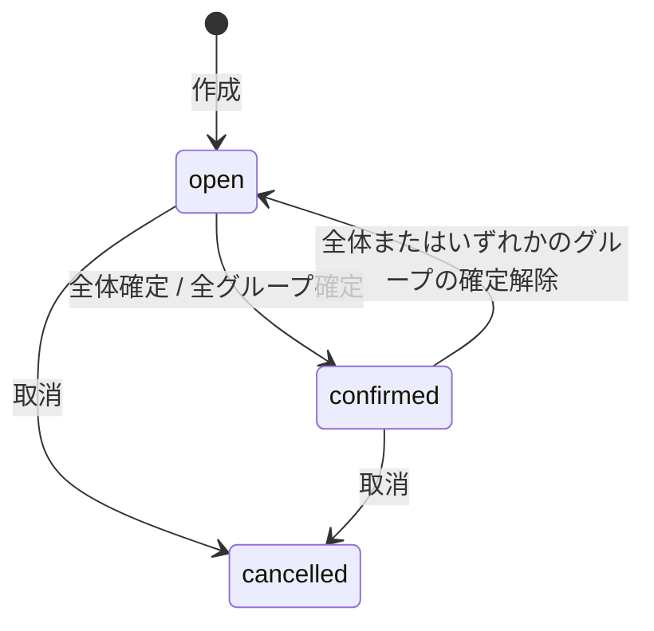

# vacaro-back API仕様書

## 1. 文書情報

| 項目 | 内容 |
|---|---|
| 対象API | vacaro-back HTTP API |
| APIバージョン | v1 |
| ベースパス | `/api/v1` |
| 仕様更新日 | 2026-09-12 |
| 実装 | Go `net/http` |
| 認証 | 暗号化されたHttpOnly Cookie |

本書は現在の小グループ調整対応APIを基準とした契約である。DB構造については[データベース設計書](database-design.md)を参照する。

## 2. 共通仕様

### 2.1 通信・データ形式

| 項目 | 仕様 |
|---|---|
| 本番プロトコル | HTTPS |
| リクエスト・レスポンス | JSON |
| Content-Type | `application/json` |
| JSONフィールド名 | `snake_case` |
| 日時 | RFC 3339。レスポンスはUTCの`Z`表記 |
| ID | UUID文字列 |
| 文字コード | UTF-8 |
| 時間区間 | 開始を含み終了を含まない`[start_at, end_at)` |
| JSONボディ上限 | 1 MiB |

JSONリクエストでは未知のフィールドを許可しない。また、1つのJSONオブジェクトの後に別の値が続くリクエストを拒否する。

### 2.2 認証

認証が必要なAPIでは次のCookieを送信する。

```http
Cookie: vacaro_session=<encrypted-value>
```

Cookie属性：

- `HttpOnly`
- `SameSite=Lax`
- `Path=/`
- 本番環境では`Secure`
- ゲストの標準有効期間は168時間
- Google認証済みユーザーの標準有効期間は720時間

本書の認証区分は次の意味を持つ。

| 区分 | 条件 |
|---|---|
| 不要 | セッションなしで利用可能 |
| 必要 | 有効なゲストまたはGoogle認証済みセッション |
| 参加者 | 対象イベントの`participants`に現在ユーザーが存在 |
| 主催者 | 対象イベントの`created_by_user_id`が現在ユーザーと一致 |
| Google認証 | `auth_accounts`に現在ユーザーのGoogleアカウントが存在 |
| Calendar連携 | Google認証済みでRefresh Tokenを保存済み |

### 2.3 リクエストID

すべてのレスポンスに`X-Request-ID`を付ける。クライアントが128文字以下の`X-Request-ID`を送った場合はその値を引き継ぎ、それ以外はサーバーが生成する。

### 2.4 成功レスポンス

通常の成功レスポンス：

```json
{
  "data": {}
}
```

一覧レスポンス：

```json
{
  "data": [],
  "meta": {}
}
```

返却データがない場合は`204 No Content`とし、ボディを返さない。ヘルスチェックとOAuthリダイレクトはこの形式の例外とする。

### 2.5 エラーレスポンス

```json
{
  "error": {
    "code": "validation_failed",
    "message": "入力内容を確認してください",
    "fields": {
      "title": "1～200文字で指定してください"
    },
    "request_id": "c4c218ac9ac85af0d8fb7250e25c5354"
  }
}
```

`fields`はフィールド単位のエラーがない場合に`null`となることがある。認証ミドルウェアの`401`や`invalid_json`では`fields`を含めない。

| HTTP Status | code | 条件 |
|---:|---|---|
| `400` | `invalid_json` | JSON不正、未知フィールド、複数JSON値 |
| `400` | `oauth_failed` | OAuthコールバック、ID Token、Google API処理の失敗 |
| `401` | `authentication_required` | セッションなし、改ざん、期限切れ |
| `403` | `permission_denied` | 主催者限定操作などの権限不足 |
| `403` | `google_authentication_required` | 回答コピーでGoogle認証がない |
| `404` | `resource_not_found` | リソースなし、イベントに未参加、無効な招待トークン |
| `409` | `already_joined` | 同一イベントへ参加済み |
| `409` | `event_not_open` | 受付中でないイベントへの更新 |
| `409` | `organizer_cannot_leave` | 主催者によるイベント退出 |
| `409` | `invalid_event_transition` | 許可されていない状態遷移 |
| `409` | `group_not_editable` | 確定済みイベントなど、グループ編成を変更できない状態 |
| `409` | `group_confirmation_exists` | 確定済みグループがあり、モード変更やグループ変更ができない |
| `409` | `calendar_not_connected` | Googleカレンダー未連携 |
| `422` | `validation_failed` | 業務入力規則への違反 |
| `500` | `internal_error` | 予期しない内部エラー |
| `503` | `google_not_configured` | サーバー側のGoogle連携設定が無効 |

## 3. リソース表現

### 3.1 User

```json
{
  "id": "0198d540-45b8-7f91-9fa8-4d7a455b1022",
  "account_type": "guest",
  "display_name": "田中",
  "email": null,
  "guest_expires_at": "2026-09-11T03:00:00Z",
  "created_at": "2026-09-04T03:00:00Z",
  "updated_at": "2026-09-04T03:00:00Z"
}
```

| フィールド | 型 | 説明 |
|---|---|---|
| `account_type` | string | `guest`または`registered` |
| `email` | string/null | Google認証済みユーザーのメールアドレス |
| `guest_expires_at` | string/null | ゲストの失効日時。登録ユーザーは`null` |

### 3.2 Event

```json
{
  "id": "0198d543-e7f0-7df2-95fa-cee649624cef",
  "created_by_user_id": "0198d540-45b8-7f91-9fa8-4d7a455b1022",
  "title": "開発ミーティング",
  "description": "次回リリースについて相談します",
  "time_zone": "Asia/Tokyo",
  "window_start_at": "2026-09-10T00:00:00Z",
  "window_end_at": "2026-09-12T12:00:00Z",
  "duration_minutes": 60,
  "scheduling_mode": "whole_event",
  "status": "open",
  "confirmed_start_at": null,
  "confirmed_end_at": null,
  "response_deadline_at": "2026-09-09T12:00:00Z",
  "created_at": "2026-09-04T03:00:00Z",
  "updated_at": "2026-09-04T03:00:00Z"
}
```

`status`は`open`、`confirmed`、`cancelled`のいずれか。`scheduling_mode`はイベント全体を1件として調整する`whole_event`、または小グループごとに調整する`groups`のいずれか。公開招待APIでは`created_by_user_id`を返さない。

### 3.3 Participant

```json
{
  "id": "0198d545-6200-7973-8609-ab29d9ab461a",
  "event_id": "0198d543-e7f0-7df2-95fa-cee649624cef",
  "user_id": "0198d540-45b8-7f91-9fa8-4d7a455b1022",
  "display_name": "田中",
  "role": "member",
  "response_status": "submitted",
  "created_at": "2026-09-04T03:10:00Z",
  "updated_at": "2026-09-04T03:20:00Z"
}
```

`role`は`organizer`または`member`、`response_status`は`pending`または`submitted`。

### 3.4 SchedulingGroup

```json
{
  "id": "0198d548-41c7-7ba0-b63e-71c9adff52ef",
  "event_id": "0198d543-e7f0-7df2-95fa-cee649624cef",
  "name": "デザインチーム",
  "duration_minutes": 45,
  "confirmed_start_at": null,
  "confirmed_end_at": null,
  "member_count": 0,
  "members": [],
  "created_at": "2026-09-04T03:30:00Z",
  "updated_at": "2026-09-04T03:30:00Z"
}
```

- `name`: イベント内で一意な1～100文字の名称
- `duration_minutes`: グループの日程確定に必要な時間。5～1,440分かつイベント期間以下
- 確定日時は両方`null`、または両方非`null`
- グループ一覧・詳細では`members`としてParticipant配列を必ず含める
- 参加者は同じイベント内の複数グループへ所属でき、未所属も許容する

### 3.5 AvailabilityInterval

```json
{
  "id": "0198d547-3c18-76ee-b85c-e99897199aef",
  "participant_id": "0198d545-6200-7973-8609-ab29d9ab461a",
  "start_at": "2026-09-10T01:00:00Z",
  "end_at": "2026-09-10T03:00:00Z",
  "source": "manual",
  "created_at": "2026-09-04T03:20:00Z",
  "updated_at": "2026-09-04T03:20:00Z"
}
```

`source`は`manual`または`google_calendar`。Googleカレンダーのプレビュー応答ではID・参加者ID・作成日時を返さない。

## 4. エンドポイント一覧

| Method | Path | 認証 | 成功 |
|---|---|---|---:|
| `GET` | `/health` | 不要 | `200` |
| `GET` | `/ready` | 不要 | `200` |
| `POST` | `/api/v1/guest-sessions` | 不要 | `201` |
| `GET` | `/api/v1/me` | 必要 | `200` |
| `PATCH` | `/api/v1/me` | 必要 | `200` |
| `DELETE` | `/api/v1/session` | 必要 | `204` |
| `POST` | `/api/v1/events` | 必要 | `201` |
| `GET` | `/api/v1/events` | 必要 | `200` |
| `GET` | `/api/v1/events/{event_id}` | 参加者 | `200` |
| `PATCH` | `/api/v1/events/{event_id}` | 主催者 | `200` |
| `DELETE` | `/api/v1/events/{event_id}` | 主催者 | `204` |
| `POST` | `/api/v1/events/{event_id}/invite-token` | 主催者 | `200` |
| `PUT` | `/api/v1/events/{event_id}/confirmation` | 主催者 | `200` |
| `DELETE` | `/api/v1/events/{event_id}/confirmation` | 主催者 | `200` |
| `GET` | `/api/v1/events/{event_id}/groups` | 参加者 | `200` |
| `POST` | `/api/v1/events/{event_id}/groups` | 主催者 | `201` |
| `GET` | `/api/v1/events/{event_id}/groups/{group_id}` | 参加者 | `200` |
| `PATCH` | `/api/v1/events/{event_id}/groups/{group_id}` | 主催者 | `200` |
| `DELETE` | `/api/v1/events/{event_id}/groups/{group_id}` | 主催者 | `204` |
| `PUT` | `/api/v1/events/{event_id}/groups/{group_id}/members` | 主催者 | `200` |
| `GET` | `/api/v1/events/{event_id}/groups/{group_id}/availability` | 参加者 | `200` |
| `GET` | `/api/v1/events/{event_id}/groups/{group_id}/candidates` | 参加者 | `200` |
| `PUT` | `/api/v1/events/{event_id}/groups/{group_id}/confirmation` | 主催者 | `200` |
| `DELETE` | `/api/v1/events/{event_id}/groups/{group_id}/confirmation` | 主催者 | `200` |
| `GET` | `/api/v1/invitations/{invite_token}` | 不要 | `200` |
| `POST` | `/api/v1/invitations/{invite_token}/participants` | 必要 | `201` |
| `GET` | `/api/v1/events/{event_id}/participants` | 参加者 | `200` |
| `DELETE` | `/api/v1/events/{event_id}/participants/me` | 一般参加者 | `204` |
| `GET` | `/api/v1/events/{event_id}/my-availability` | 参加者 | `200` |
| `PUT` | `/api/v1/events/{event_id}/my-availability` | 参加者 | `200` |
| `POST` | `/api/v1/events/{event_id}/my-availability/copy` | Google認証・参加者 | `200` |
| `GET` | `/api/v1/events/{event_id}/availability` | 参加者 | `200` |
| `GET` | `/api/v1/events/{event_id}/candidates` | 参加者 | `200` |
| `GET` | `/api/v1/auth/google/start` | 不要 | `303` |
| `GET` | `/api/v1/auth/google/callback` | 不要 | `303` |
| `POST` | `/api/v1/integrations/google-calendar` | Google認証 | `200` |
| `GET` | `/api/v1/integrations/google-calendar/calendars` | Google認証・Calendar連携 | `200` |
| `GET` | `/api/v1/integrations/google-calendar/callback` | Google認証 | `303` |
| `DELETE` | `/api/v1/integrations/google-calendar` | Google認証・Calendar連携 | `204` |
| `POST` | `/api/v1/events/{event_id}/google-calendar-availability/preview` | 参加者・Calendar連携 | `200` |

## 5. システム

### 5.1 Liveness

```http
GET /health
```

DBへ接続せず、APIプロセスの生存を確認する。

```json
{"status":"ok"}
```

### 5.2 Readiness

```http
GET /ready
```

2秒以内にDBへ接続できた場合は`200`を返す。

```json
{"status":"ok"}
```

接続できない場合は`503`を返す。

```json
{"status":"unavailable"}
```

## 6. セッション・ユーザー

### 6.1 ゲストセッション作成

```http
POST /api/v1/guest-sessions
```

Request：

```json
{"display_name":"田中"}
```

- `display_name`: 前後空白を除いて1～100文字
- ゲストユーザーとセッションCookieを作成
- Response: `201`、`data`はUser

### 6.2 自分の情報取得

```http
GET /api/v1/me
```

Response: `200`、`data`はUser。

### 6.3 表示名変更

```http
PATCH /api/v1/me
```

```json
{"display_name":"新しい表示名"}
```

Response: `200`、`data`は更新後のUser。

### 6.4 ログアウト

```http
DELETE /api/v1/session
```

セッションCookieを削除し、`204`を返す。

## 7. イベント

### 7.1 イベント作成

```http
POST /api/v1/events
```

```json
{
  "title": "開発ミーティング",
  "description": "次回リリースについて相談します",
  "time_zone": "Asia/Tokyo",
  "window_start_at": "2026-09-10T00:00:00Z",
  "window_end_at": "2026-09-12T12:00:00Z",
  "duration_minutes": 60,
  "scheduling_mode": "whole_event",
  "response_deadline_at": "2026-09-09T12:00:00Z"
}
```

入力規則：

- `title`: 必須、1～200文字
- `description`: 任意、最大5,000文字。空白だけの場合は`null`として保存
- `time_zone`: 必須、有効なIANAタイムゾーン
- `window_start_at`: 必須
- `window_end_at`: 必須、`window_start_at`より後
- `duration_minutes`: 5～1,440分かつイベント期間以下
- `scheduling_mode`: `whole_event`または`groups`。省略時は`whole_event`
- `response_deadline_at`: 任意、`window_end_at`以前

作成者は同じトランザクションで主催者として参加する。Response: `201`。

```json
{
  "data": {
    "id": "0198d543-e7f0-7df2-95fa-cee649624cef",
    "status": "open",
    "invite_token": "<random-token>",
    "invite_url": "http://localhost:3000/invitations/<random-token>"
  }
}
```

実際のレスポンスにはEventの全フィールドも含む。生の招待トークンは作成時と再発行時だけ返す。

### 7.2 イベント一覧

```http
GET /api/v1/events?status=open&limit=20&cursor=<opaque-cursor>
```

| Query | 省略時 | 制約 |
|---|---:|---|
| `status` | 全状態 | `open`、`confirmed`、`cancelled` |
| `limit` | `20` | 最大`100`。0以下や数値以外も`20` |
| `cursor` | 先頭 | レスポンスで得た値をそのまま指定 |

現在ユーザーが参加しているイベントを`created_at DESC, id DESC`で返す。

```json
{
  "data": [],
  "meta": {"next_cursor": null}
}
```

### 7.3 イベント詳細

```http
GET /api/v1/events/{event_id}
```

Response: `200`、`data`はEvent。未参加の場合は`404`。

### 7.4 イベント更新

```http
PATCH /api/v1/events/{event_id}
```

主催者かつ`open`状態の場合のみ更新できる。すべてのフィールドは任意。

```json
{
  "title": "更新後タイトル",
  "description": null,
  "time_zone": "Asia/Tokyo",
  "window_start_at": "2026-09-10T00:00:00Z",
  "window_end_at": "2026-09-11T12:00:00Z",
  "duration_minutes": 90,
  "scheduling_mode": "groups",
  "response_deadline_at": null
}
```

`description`と`response_deadline_at`へ`null`を送ると値を削除する。変更後の期間が登録済み参加可能時間を除外する場合は`422`。Response: `200`、更新後のEvent。

`scheduling_mode`の変更は次の場合だけ許可する。

- イベントが`open`
- イベント全体またはグループに確定日時が存在しない
- `groups`から`whole_event`へ戻す場合、グループが1件も存在しない

### 7.5 イベント取消

```http
DELETE /api/v1/events/{event_id}
```

イベントを物理削除せず`cancelled`にし、`204`を返す。既に取消済みの場合も`204`。

### 7.6 招待トークン再発行

```http
POST /api/v1/events/{event_id}/invite-token
```

主催者かつ`open`状態で利用できる。以前のトークンは直ちに無効になる。Response: `200`、Eventに新しい`invite_token`と`invite_url`を加えた形式。

### 7.7 日程確定

```http
PUT /api/v1/events/{event_id}/confirmation
```

```json
{
  "start_at": "2026-09-10T01:00:00Z",
  "end_at": "2026-09-10T02:00:00Z"
}
```

- イベント期間内であること
- `end_at - start_at`が`duration_minutes`と一致すること
- 主催者のみ実行可能
- `scheduling_mode = whole_event`であること

Response: `200`、`status=confirmed`のEvent。

### 7.8 確定解除

```http
DELETE /api/v1/events/{event_id}/confirmation
```

`confirmed`から`open`へ戻し、確定日時を`null`にする。Response: `200`、更新後のEvent。

`scheduling_mode = whole_event`であること。小グループの確定解除はグループ用エンドポイントを使用する。

## 8. 小グループ

小グループAPIは`Event.scheduling_mode = groups`の場合だけ利用できる。グループ編成の変更は主催者に限定し、イベントが`open`の間だけ許可する。回答はイベント単位で保持し、参加者へグループごとの再回答を要求しない。

### 8.1 グループ一覧

```http
GET /api/v1/events/{event_id}/groups
```

作成日時順のSchedulingGroup配列を返す。各要素は`members`として所属するParticipant配列を含む。イベント参加者が閲覧できる。

### 8.2 グループ作成

```http
POST /api/v1/events/{event_id}/groups
```

```json
{
  "name": "デザインチーム",
  "duration_minutes": 45,
  "participant_ids": [
    "0198d545-6200-7973-8609-ab29d9ab461a"
  ]
}
```

- `name`: 必須、前後空白を除いて1～100文字、イベント内で一意
- `duration_minutes`: 省略時はイベントの`duration_minutes`を使用
- `participant_ids`: 省略時は空配列。対象イベントの参加者IDだけを指定可能
- 重複した参加者IDは`422`

グループとメンバーを同一トランザクションで作成する。Response: `201`、`data`は`members`を含むSchedulingGroup。

### 8.3 グループ詳細

```http
GET /api/v1/events/{event_id}/groups/{group_id}
```

Response: `200`、`data`は`members`を含むSchedulingGroup。グループが対象イベントに属さない場合も`404`。

### 8.4 グループ更新

```http
PATCH /api/v1/events/{event_id}/groups/{group_id}
```

```json
{
  "name": "プロダクトチーム",
  "duration_minutes": 60
}
```

両フィールドとも任意。確定済みグループの`duration_minutes`は変更できず`409 group_confirmation_exists`。Response: `200`、更新後のSchedulingGroup。

### 8.5 グループ削除

```http
DELETE /api/v1/events/{event_id}/groups/{group_id}
```

メンバーとの関連を同時に削除する。確定済みグループは削除できず`409 group_confirmation_exists`。成功時は`204`。

### 8.6 グループメンバー一括置換

```http
PUT /api/v1/events/{event_id}/groups/{group_id}/members
```

```json
{
  "participant_ids": [
    "0198d545-6200-7973-8609-ab29d9ab461a",
    "0198d546-135a-73c0-b064-2a8ef7652fc8"
  ]
}
```

対象グループのメンバーを指定された参加者で一括置換する。空配列を許容する。参加者は同じイベントに所属していなければならない。確定済みグループのメンバーは変更できない。Response: `200`、`data`は更新後の`members`を含むSchedulingGroup。

### 8.7 グループ回答状況

```http
GET /api/v1/events/{event_id}/groups/{group_id}/availability
```

グループメンバーだけを対象に、10.4と同じParticipantAvailability配列を返す。メンバーが0人の場合は空配列。

### 8.8 グループ共通候補日時

```http
GET /api/v1/events/{event_id}/groups/{group_id}/candidates?limit=20
```

10.5と同じCandidate配列を返す。ただし、計算対象はグループメンバー、必要時間はグループの`duration_minutes`とする。未回答のグループメンバーも`total_participant_count`に含める。フロント側では候補を再計算しない。

### 8.9 グループ日程確定

```http
PUT /api/v1/events/{event_id}/groups/{group_id}/confirmation
```

```json
{
  "start_at": "2026-09-10T01:00:00Z",
  "end_at": "2026-09-10T01:45:00Z"
}
```

- イベント期間内であること
- `end_at - start_at`がグループの`duration_minutes`と一致すること
- グループに1人以上のメンバーが存在すること
- 主催者のみ実行可能

Response: `200`、`data`は更新後のSchedulingGroup。全グループに確定日時が設定された場合、同一トランザクションでイベントを`confirmed`へ変更する。

### 8.10 グループ確定解除

```http
DELETE /api/v1/events/{event_id}/groups/{group_id}/confirmation
```

グループの確定日時を`null`へ戻す。イベントが`confirmed`の場合は同一トランザクションで`open`へ戻す。Response: `200`、`data`は更新後のSchedulingGroup。

## 9. 招待・参加者

### 9.1 公開招待情報

```http
GET /api/v1/invitations/{invite_token}
```

Response: `200`、`created_by_user_id`を除いたEvent。無効なトークンまたは取消済みイベントは`404`。

### 9.2 イベント参加

```http
POST /api/v1/invitations/{invite_token}/participants
```

```json
{"display_name":"田中"}
```

- `display_name`: 前後空白を除いて1～100文字
- イベントは`open`であること
- 同じユーザーが参加済みの場合は`409 already_joined`
- Response: `201`、`data`は作成されたParticipant

### 9.3 参加者一覧

```http
GET /api/v1/events/{event_id}/participants
```

Response: `200`、`data`はParticipant配列。主催者を先頭に、作成日時順で返す。

### 9.4 イベント退出

```http
DELETE /api/v1/events/{event_id}/participants/me
```

一般参加者をイベントから削除し、回答も同時に削除する。主催者は退出できず`409 organizer_cannot_leave`。成功時は`204`。

## 10. 参加可能時間・候補

### 10.1 自分の回答取得

```http
GET /api/v1/events/{event_id}/my-availability
```

```json
{
  "data": {
    "response_status": "submitted",
    "intervals": []
  }
}
```

`intervals`は開始日時順のAvailabilityInterval配列。

### 10.2 自分の回答を一括置換

```http
PUT /api/v1/events/{event_id}/my-availability
```

```json
{
  "intervals": [
    {
      "start_at": "2026-09-10T01:00:00Z",
      "end_at": "2026-09-10T03:00:00Z"
    }
  ]
}
```

- 最大100区間
- イベントは`open`であること
- 各区間はイベント期間内かつ`start_at < end_at`
- 重複区間は`422`
- 隣接区間は統合
- 既存回答をすべて置換
- 空配列は「参加可能時間なし」という提出済み回答

Response: `200`。

```json
{
  "data": {
    "response_status": "submitted",
    "intervals": []
  }
}
```

### 10.3 別イベントから回答をコピー

```http
POST /api/v1/events/{target_event_id}/my-availability/copy
```

```json
{"source_event_id":"0198d543-e7f0-7df2-95fa-cee649624cef"}
```

- Google認証必須
- コピー元とコピー先の両方に参加していること
- コピー元とコピー先は別イベントであること
- コピー元の回答が`submitted`であること
- コピー先は`open`であること
- コピー先期間と重なる絶対日時だけを切り取ってコピー
- コピー先の既存回答は維持し、重複・隣接区間を統合
- コピー元に区間があるが重なる区間がない場合は`422`

時刻だけを別日へ移動する機能ではない。Response: `200`、一括置換と同じ形式。

### 10.4 全参加者の回答取得

```http
GET /api/v1/events/{event_id}/availability
```

```json
{
  "data": [
    {
      "participant": {},
      "intervals": []
    }
  ]
}
```

Response: `200`。参加者ごとにParticipantとAvailabilityInterval配列を返す。

### 10.5 共通候補日時

```http
GET /api/v1/events/{event_id}/candidates?limit=20
```

```json
{
  "data": [
    {
      "start_at": "2026-09-10T01:00:00Z",
      "end_at": "2026-09-10T02:00:00Z",
      "available_participant_count": 2,
      "total_participant_count": 3,
      "available_participant_ids": ["0198d545-6200-7973-8609-ab29d9ab461a"]
    }
  ],
  "meta": {"limit": 20}
}
```

イベント全参加者を対象に、イベントの`duration_minutes`を満たす開始候補を参加可能人数の降順、同数なら開始日時の昇順で返す。`groups`モードでもresults画面の「全体」表示で利用できる。未回答者は`total_participant_count`には含むが参加可能人数には含めない。`limit`は標準20、最大100。グループ別候補には8.8のエンドポイントを使用する。

## 11. Google認証・Calendar連携

Google関連の環境変数がすべて未設定の場合、Google以外のAPIは通常どおり利用できる。Google OAuth・Calendar APIは`503 google_not_configured`を返す。

### 11.1 Googleログイン開始

```http
GET /api/v1/auth/google/start
```

暗号化した10分間有効のOAuth state Cookieを設定し、Google認可画面へ`303 See Other`でリダイレクトする。ゲストセッションがあれば、そのユーザーIDをstateへ関連付ける。

### 11.2 Googleログインコールバック

```http
GET /api/v1/auth/google/callback?code=<code>&state=<state>
```

次を検証する。

- state Cookie、state値、有効期限、用途
- ID Tokenの署名・issuer・audience・有効期限
- nonce
- `email_verified`

Googleの`sub`をアカウント識別子として使用し、メールアドレスだけでは同一人物と判定しない。ゲストから開始した場合は、そのゲストが所有・参加するイベントをGoogleユーザーへ引き継ぐ。

成功時は登録ユーザー用Cookieを設定し、次へ`303`でリダイレクトする。

```text
{PUBLIC_APP_URL}?google_login=success
```

### 11.3 Googleカレンダー連携開始

```http
POST /api/v1/integrations/google-calendar
```

Google認証済みセッションが必要。Calendar FreeBusy権限とカレンダー一覧の読み取り権限を求める認可URLを返す。

```json
{
  "data": {
    "authorization_url": "https://accounts.google.com/o/oauth2/auth?..."
  }
}
```

### 11.4 Googleカレンダーコールバック

```http
GET /api/v1/integrations/google-calendar/callback?code=<code>&state=<state>
```

開始時と同じ登録ユーザーのセッションとstate Cookieが必要。取得したRefresh TokenはAES-GCMで暗号化してDBへ保存する。

成功時は次へ`303`でリダイレクトする。

```text
{PUBLIC_APP_URL}/account?google_calendar=connected
```

### 11.5 Googleカレンダー一覧

```http
GET /api/v1/integrations/google-calendar/calendars
```

空き時間の判定対象として選択できるメイン・共有・サブカレンダーを返す。予定のタイトルや内容は返さない。

```json
{
  "data": {
    "calendars": [
      {
        "id": "user@example.com",
        "summary": "メインカレンダー",
        "primary": true,
        "selected": true,
        "background_color": "#4285f4"
      }
    ]
  }
}
```

### 11.6 Googleカレンダー連携解除

```http
DELETE /api/v1/integrations/google-calendar
```

Google側でRefresh Tokenを失効させた後、DBの暗号文を削除する。成功時は`204`。未連携の場合は`409 calendar_not_connected`。

### 11.7 空き時間プレビュー

```http
POST /api/v1/events/{event_id}/google-calendar-availability/preview
```

```json
{"calendar_ids":["primary"]}
```

- `calendar_ids`: 省略または空配列なら`["primary"]`
- 最大50件
- 空文字列は不可
- 対象イベントへの参加とCalendar連携が必要

イベント期間をGoogle Calendar FreeBusy APIへ問い合わせ、予定あり区間を除いた時間を返す。予定のタイトル・説明・参加者は取得・返却しない。このAPIはプレビュー専用でDBへ保存しない。

```json
{
  "data": {
    "intervals": [
      {
        "start_at": "2026-09-10T01:00:00Z",
        "end_at": "2026-09-10T02:00:00Z",
        "source": "google_calendar"
      }
    ]
  }
}
```

## 12. イベント状態遷移



| 現在 | 操作 | 結果 |
|---|---|---|
| `open` | 参加・回答・内容更新 | 許可 |
| `open` | `whole_event`の全体日時を確定 | `confirmed` |
| `open` | `groups`の一部グループを確定 | `open`のまま |
| `open` | `groups`の全グループを確定 | `confirmed` |
| `open` | 取消 | `cancelled` |
| `confirmed` | 全体またはいずれかのグループの確定解除 | `open` |
| `confirmed` | 取消 | `cancelled` |
| `confirmed` | 参加・回答・内容更新 | 拒否 |
| `cancelled` | 再度取消 | `cancelled`のまま成功 |
| `cancelled` | その他の変更 | 拒否 |

`groups`モードはグループ0件の準備中状態を許容するが、この状態で`confirmed`へ遷移することはない。

## 13. 現在の制約と本番運用上の注意

- フロントエンドとAPIは同一サイト配下での利用を前提とする。
- CORSミドルウェア、Origin検証、CSRFトークンは現時点では未実装。
- APIレート制限は未実装。
- サーバー側セッションテーブルはなく、Cookieの個別即時失効や端末別管理は行わない。
- イベントIDなどのUUID形式をHandler層で事前検証していないため、不正形式へのエラー整形は今後の改善対象。
- 未定義パスの`404`と許可されていないHTTPメソッドの`405`は、現時点ではGo標準Muxのプレーンテキスト応答となる。
- Google OAuthの実環境動作にはGoogle Cloud ConsoleのOAuthクライアントと許可済みリダイレクトURIが必要。
- `SESSION_KEY`と`TOKEN_ENCRYPTION_KEY`は別々の32バイト鍵をBase64化し、Secret Manager等から供給する。
