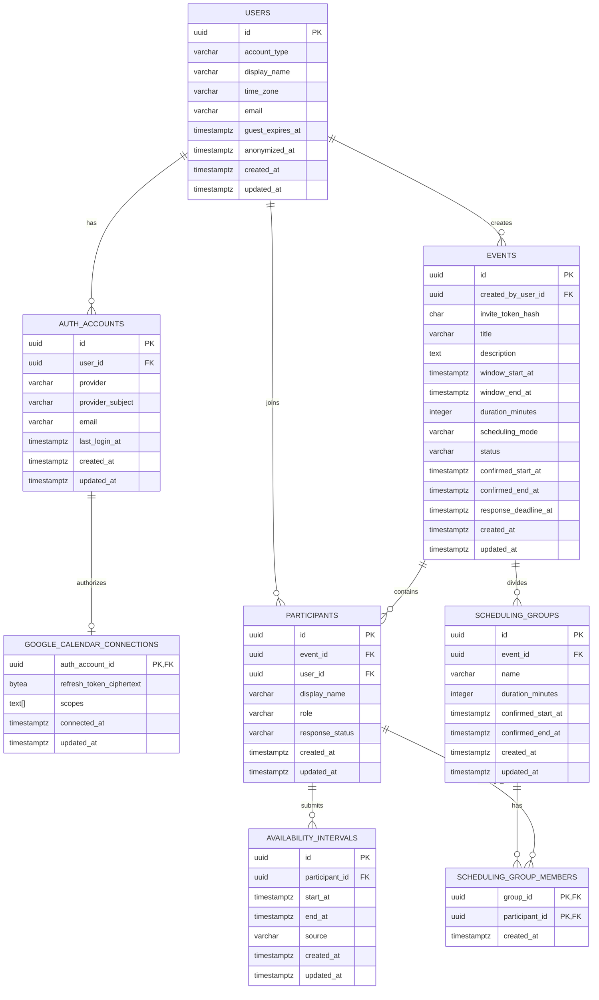

# vacaro-back データベース設計書

## 1. 目的

vacaro-backは、参加者があらかじめ用意された候補枠へ回答するのではなく、参加可能な開始・終了日時を自由に登録する日程調整サービスである。

本設計は次の機能を対象とする。

- Google認証ユーザーとゲストユーザーの管理
- 日程調整イベントの作成と共有
- イベントへの参加
- 参加可能時間帯の登録
- イベント全体または小グループ単位の調整結果の確定
- 小グループの作成と参加者編成
- GoogleアカウントおよびGoogleカレンダー連携

## 2. 前提と設計方針

- DBMSはPostgreSQL 18を使用する。
- 主キーは推測されにくく、分散環境でも生成できるUUIDとする。
- すべての日時は`TIMESTAMPTZ`で保存する。DBとAPI間ではUTCを使用する。
- ユーザーごとに表示用のIANAタイムゾーン名を保持し、イベント日時はUTCだけで管理する。
- 時間区間は開始を含み終了を含まない半開区間`[start_at, end_at)`として扱う。
- テーブル名とカラム名は`snake_case`、テーブル名は複数形とする。
- 作成・更新日時は原則として`created_at`と`updated_at`へ記録する。
- ユーザー削除は物理削除ではなく匿名化を基本とし、過去の調整データとの整合性を維持する。
- OAuthトークンをログへ出力しない。DBへ保存する場合は、アプリケーション側で暗号化する。

## 3. ER図



## 4. テーブル定義

### 4.1 `users`

サービス内のユーザーを表す。ゲストユーザーも一時的な`users`レコードとして管理し、後からGoogle認証ユーザーへ昇格できるようにする。

| カラム | 型 | NULL | デフォルト | 説明 |
|---|---|---:|---|---|
| `id` | `UUID` | NO | `gen_random_uuid()` | ユーザーID |
| `account_type` | `VARCHAR(20)` | NO | `'guest'` | `guest`または`registered` |
| `display_name` | `VARCHAR(100)` | NO | - | 表示名 |
| `time_zone` | `VARCHAR(100)` | NO | `'UTC'` | 日時の入力・表示に使用するIANAタイムゾーン |
| `email` | `VARCHAR(320)` | YES | - | 連絡先メールアドレス |
| `guest_expires_at` | `TIMESTAMPTZ` | YES | - | ゲストデータの有効期限 |
| `anonymized_at` | `TIMESTAMPTZ` | YES | - | 匿名化日時 |
| `created_at` | `TIMESTAMPTZ` | NO | `CURRENT_TIMESTAMP` | 作成日時 |
| `updated_at` | `TIMESTAMPTZ` | NO | `CURRENT_TIMESTAMP` | 更新日時 |

制約：

- 主キー：`id`
- `account_type IN ('guest', 'registered')`
- `account_type = 'guest'`の場合、`guest_expires_at`を必須とする。
- メールアドレスだけで本人同一性を判断しない。Googleユーザーの一意性は`auth_accounts`で保証する。

### 4.2 `auth_accounts`

ユーザーと外部認証プロバイダーのIDを関連付ける。初期対応プロバイダーはGoogleのみだが、ユーザーテーブルから分離して将来の追加に備える。

| カラム | 型 | NULL | デフォルト | 説明 |
|---|---|---:|---|---|
| `id` | `UUID` | NO | `gen_random_uuid()` | 認証アカウントID |
| `user_id` | `UUID` | NO | - | `users.id` |
| `provider` | `VARCHAR(30)` | NO | - | 初期値は`google` |
| `provider_subject` | `VARCHAR(255)` | NO | - | Google ID Tokenの`sub` |
| `email` | `VARCHAR(320)` | YES | - | プロバイダーから取得したメールアドレス |
| `last_login_at` | `TIMESTAMPTZ` | YES | - | 最終ログイン日時 |
| `created_at` | `TIMESTAMPTZ` | NO | `CURRENT_TIMESTAMP` | 作成日時 |
| `updated_at` | `TIMESTAMPTZ` | NO | `CURRENT_TIMESTAMP` | 更新日時 |

制約・インデックス：

- 主キー：`id`
- 外部キー：`user_id -> users.id ON DELETE CASCADE`
- 一意制約：`(provider, provider_subject)`
- 一意制約：`(user_id, provider)`

### 4.3 `google_calendar_connections`

Googleカレンダーへのアクセス許可を保持する。Googleログインのみ利用し、カレンダー連携を許可していないユーザーにはレコードを作成しない。

| カラム | 型 | NULL | デフォルト | 説明 |
|---|---|---:|---|---|
| `auth_account_id` | `UUID` | NO | - | Googleの`auth_accounts.id` |
| `refresh_token_ciphertext` | `BYTEA` | NO | - | 暗号化したRefresh Token |
| `scopes` | `TEXT[]` | NO | `'{}'` | 許可されたOAuth Scope |
| `connected_at` | `TIMESTAMPTZ` | NO | `CURRENT_TIMESTAMP` | 連携開始日時 |
| `updated_at` | `TIMESTAMPTZ` | NO | `CURRENT_TIMESTAMP` | 更新日時 |

制約：

- 主キー兼外部キー：`auth_account_id -> auth_accounts.id ON DELETE CASCADE`
- 暗号鍵はDBに保存せず、デプロイ環境のSecret Managerなどで管理する。
- Access Tokenは短命なため原則として永続化せず、必要に応じて都度更新する。

### 4.4 `events`

1件の日程調整を表す。

| カラム | 型 | NULL | デフォルト | 説明 |
|---|---|---:|---|---|
| `id` | `UUID` | NO | `gen_random_uuid()` | イベントID |
| `created_by_user_id` | `UUID` | NO | - | 作成者の`users.id` |
| `invite_token_hash` | `CHAR(64)` | NO | - | 招待URL用トークンのSHA-256ハッシュ |
| `title` | `VARCHAR(200)` | NO | - | イベント名 |
| `description` | `TEXT` | YES | - | 説明 |
| `window_start_at` | `TIMESTAMPTZ` | NO | - | 回答可能期間の開始 |
| `window_end_at` | `TIMESTAMPTZ` | NO | - | 回答可能期間の終了 |
| `duration_minutes` | `INTEGER` | NO | - | 必要な予定時間 |
| `scheduling_mode` | `VARCHAR(20)` | NO | `'whole_event'` | `whole_event`または`groups` |
| `status` | `VARCHAR(20)` | NO | `'open'` | `open`、`confirmed`、`cancelled` |
| `confirmed_start_at` | `TIMESTAMPTZ` | YES | - | 確定した開始日時 |
| `confirmed_end_at` | `TIMESTAMPTZ` | YES | - | 確定した終了日時 |
| `response_deadline_at` | `TIMESTAMPTZ` | YES | - | 回答期限 |
| `created_at` | `TIMESTAMPTZ` | NO | `CURRENT_TIMESTAMP` | 作成日時 |
| `updated_at` | `TIMESTAMPTZ` | NO | `CURRENT_TIMESTAMP` | 更新日時 |

制約・インデックス：

- 主キー：`id`
- 外部キー：`created_by_user_id -> users.id ON DELETE RESTRICT`
- 一意制約：`invite_token_hash`
- `window_start_at < window_end_at`
- `duration_minutes > 0`
- `scheduling_mode IN ('whole_event', 'groups')`
- 確定日時は両方NULL、または両方非NULLかつ`confirmed_start_at < confirmed_end_at`とする。
- `scheduling_mode = groups`の場合、イベント本体の確定日時は両方NULLとする。このテーブル単独では表現しにくいためService層でも検証する。
- インデックス：`(created_by_user_id, created_at DESC)`
- インデックス：`(status, response_deadline_at)`

招待URLには十分な長さのランダムトークンを含める。DBには生のトークンを保存せず、SHA-256ハッシュだけを保存して、受信したトークンのハッシュで検索する。

### 4.5 `participants`

イベントとユーザーの参加関係を表す。イベントごとに異なる表示名を設定できる。

| カラム | 型 | NULL | デフォルト | 説明 |
|---|---|---:|---|---|
| `id` | `UUID` | NO | `gen_random_uuid()` | 参加者ID |
| `event_id` | `UUID` | NO | - | `events.id` |
| `user_id` | `UUID` | NO | - | `users.id` |
| `display_name` | `VARCHAR(100)` | NO | - | イベント内の表示名 |
| `role` | `VARCHAR(20)` | NO | `'member'` | `organizer`または`member` |
| `response_status` | `VARCHAR(20)` | NO | `'pending'` | `pending`または`submitted` |
| `created_at` | `TIMESTAMPTZ` | NO | `CURRENT_TIMESTAMP` | 参加日時 |
| `updated_at` | `TIMESTAMPTZ` | NO | `CURRENT_TIMESTAMP` | 更新日時 |

制約・インデックス：

- 主キー：`id`
- 外部キー：`event_id -> events.id ON DELETE CASCADE`
- 外部キー：`user_id -> users.id ON DELETE RESTRICT`
- 一意制約：`(event_id, user_id)`
- インデックス：`user_id`
- イベント作成者については、`role = 'organizer'`の参加者レコードも同一トランザクション内で作成する。

### 4.6 `scheduling_groups`

小グループごとの調整条件と確定日時を表す。参加可能時間の回答は複製せず、所属参加者の`availability_intervals`を参照して候補を計算する。

| カラム | 型 | NULL | デフォルト | 説明 |
|---|---|---:|---|---|
| `id` | `UUID` | NO | `gen_random_uuid()` | グループID |
| `event_id` | `UUID` | NO | - | `events.id` |
| `name` | `VARCHAR(100)` | NO | - | イベント内のグループ名 |
| `duration_minutes` | `INTEGER` | NO | - | グループの日程確定に必要な時間 |
| `confirmed_start_at` | `TIMESTAMPTZ` | YES | - | 確定した開始日時 |
| `confirmed_end_at` | `TIMESTAMPTZ` | YES | - | 確定した終了日時 |
| `created_at` | `TIMESTAMPTZ` | NO | `CURRENT_TIMESTAMP` | 作成日時 |
| `updated_at` | `TIMESTAMPTZ` | NO | `CURRENT_TIMESTAMP` | 更新日時 |

制約・インデックス：

- 主キー：`id`
- 外部キー：`event_id -> events.id ON DELETE CASCADE`
- 一意制約：`(event_id, name)`
- `duration_minutes > 0`
- 確定日時は両方NULL、または両方非NULLかつ`confirmed_start_at < confirmed_end_at`とする。
- インデックス：`(event_id, created_at)`

### 4.7 `scheduling_group_members`

小グループとイベント参加者の多対多関係を表す。同じ参加者が複数グループへ所属すること、およびどのグループにも所属しないことを許容する。

| カラム | 型 | NULL | デフォルト | 説明 |
|---|---|---:|---|---|
| `group_id` | `UUID` | NO | - | `scheduling_groups.id` |
| `participant_id` | `UUID` | NO | - | `participants.id` |
| `created_at` | `TIMESTAMPTZ` | NO | `CURRENT_TIMESTAMP` | 所属作成日時 |

制約・インデックス：

- 複合主キー：`(group_id, participant_id)`
- 外部キー：`group_id -> scheduling_groups.id ON DELETE CASCADE`
- 外部キー：`participant_id -> participants.id ON DELETE CASCADE`
- インデックス：`participant_id`
- グループと参加者が同じイベントに属することはService層で検証する。

### 4.8 `availability_intervals`

参加者が入力した参加可能時間帯を表す。1人の参加者が複数の時間帯を登録できる。

| カラム | 型 | NULL | デフォルト | 説明 |
|---|---|---:|---|---|
| `id` | `UUID` | NO | `gen_random_uuid()` | 参加可能時間ID |
| `participant_id` | `UUID` | NO | - | `participants.id` |
| `start_at` | `TIMESTAMPTZ` | NO | - | 参加可能時間の開始 |
| `end_at` | `TIMESTAMPTZ` | NO | - | 参加可能時間の終了 |
| `source` | `VARCHAR(20)` | NO | `'manual'` | `manual`または`google_calendar` |
| `created_at` | `TIMESTAMPTZ` | NO | `CURRENT_TIMESTAMP` | 作成日時 |
| `updated_at` | `TIMESTAMPTZ` | NO | `CURRENT_TIMESTAMP` | 更新日時 |

制約・インデックス：

- 主キー：`id`
- 外部キー：`participant_id -> participants.id ON DELETE CASCADE`
- `start_at < end_at`
- インデックス：`(participant_id, start_at)`
- 同一参加者の時間帯が重複しないよう、PostgreSQLの排他制約を使用する。

排他制約の想定：

```sql
CREATE EXTENSION IF NOT EXISTS btree_gist;

ALTER TABLE availability_intervals
ADD CONSTRAINT availability_intervals_no_overlap
EXCLUDE USING gist (
    participant_id WITH =,
    tstzrange(start_at, end_at, '[)') WITH &&
);
```

隣接する`10:00–11:00`と`11:00–12:00`は重複とみなさない。APIでは可能であれば隣接区間を`10:00–12:00`へ統合する。

## 5. 主要な整合性ルール

DB制約だけでは他テーブルの値を参照する一部のルールを表現しにくいため、次はService層で同一トランザクション内に検証する。

1. 参加可能時間はイベントの`window_start_at`以上、`window_end_at`以下であること。
2. `whole_event`の確定日時はイベントの`duration_minutes`、グループの確定日時はグループの`duration_minutes`と一致させること。
3. イベント作成者と`organizer`参加者の`user_id`が一致すること。
4. `cancelled`または`confirmed`のイベントには新しい回答を登録できないこと。
5. Googleカレンダー由来の時間帯は、連携を解除した後も残すか削除するかをユーザー操作として明示すること。
6. `scheduling_groups`と所属する`participants`は同じイベントに属すること。
7. `groups`モードではグループ0件の準備中状態を許容する。グループが1件以上あり、全グループが確定したときだけイベントを`confirmed`にし、一部だけ確定した状態では`open`のままとする。
8. 確定済みグループの必要時間・メンバー編成・削除は許可しないこと。

## 6. トランザクション境界

次の処理は1トランザクションで実行する。

- イベント作成：`events`作成と主催者の`participants`作成
- ゲスト参加：`users`作成と`participants`作成
- ゲストからGoogleユーザーへの昇格：`users`更新と`auth_accounts`作成
- 回答更新：既存の`availability_intervals`更新と`response_status`更新
- 全体日程確定：`events`の確定日時・ステータス更新と、対象参加者の他の調整中イベントから確定時間を除外
- グループ作成・メンバー一括置換：`scheduling_groups`と`scheduling_group_members`の更新
- グループ日程確定：`scheduling_groups`の確定日時・`events.status`の更新と、グループメンバーの他の調整中イベントから確定時間を除外
- グループ確定解除：`scheduling_groups`の確定日時と`events.status`の更新

回答更新では、対象参加者のレコードまたはイベントを`SELECT ... FOR UPDATE`でロックし、同時更新による回答消失を防ぐ。

## 7. ゲストユーザーのライフサイクル

1. 招待URLから参加した時点で`account_type = 'guest'`のユーザーを作成する。
2. MVPではユーザーIDと有効期限を含む署名・暗号化Cookieを発行し、セッショントークン自体はDBへ保存しない。
3. Google認証を行った場合は、同一ユーザーへ`auth_accounts`を追加し、`account_type`を`registered`へ変更する。
4. 期限切れゲストは、参加中イベントの保存期間を考慮した上でバッチ処理により匿名化する。

Cookieには`HttpOnly`、`Secure`、`SameSite`属性を設定する。サーバー側からの即時失効や複数端末のセッション管理が必要になった場合は、`sessions`テーブルを追加する。

## 8. Googleカレンダー連携方針

- Googleの予定タイトル、説明、参加者などの不要な個人情報は保存しない。
- FreeBusy APIなどから取得した情報を利用し、アプリ内では参加可能時間またはビジー時間との差分だけを扱う。
- カレンダーから生成した参加可能時間を永続化する場合は、`source = 'google_calendar'`とする。
- 確定日時は、書き込み権限を許可した参加者のメインカレンダーへ固定IDでupsertし、確定解除時に削除する。
- OAuth Scopeは必要最小限とする。
- Refresh Tokenは暗号化して保存し、暗号鍵はDBとは別のSecret Managerで管理する。
- 連携解除時はGoogle側の認可を失効させ、`google_calendar_connections`を削除する。

## 9. MVPと将来拡張の境界

### MVPで作成するテーブル

1. `users`
2. `events`
3. `participants`
4. `availability_intervals`

### 小グループ調整で追加するテーブル

1. `scheduling_groups`
2. `scheduling_group_members`

### Google連携実装時に追加するテーブル

1. `auth_accounts`
2. `google_calendar_connections`

### 必要になってから検討するテーブル

- `event_candidates`: 共通空き時間の計算結果をキャッシュする場合
- `event_audit_logs`: 確定・取消などの操作履歴が必要な場合
- `sessions`: サーバー側セッション方式を採用する場合
- `outbox_events`: メール通知などを非同期かつ確実に送信する場合

共通空き時間は、初期段階では`availability_intervals`から都度計算し、性能上の問題が確認されるまで結果テーブルを追加しない。

## 10. マイグレーション予定

```text
db/migrations/
├── 000001_create_users.up.sql
├── 000001_create_users.down.sql
├── 000002_create_events.up.sql
├── 000002_create_events.down.sql
├── 000003_create_participants.up.sql
├── 000003_create_participants.down.sql
├── 000004_create_availability_intervals.up.sql
├── 000004_create_availability_intervals.down.sql
├── 000006_add_scheduling_mode_to_events.up.sql
├── 000006_add_scheduling_mode_to_events.down.sql
├── 000007_create_scheduling_groups.up.sql
├── 000007_create_scheduling_groups.down.sql
├── 000008_create_scheduling_group_members.up.sql
└── 000008_create_scheduling_group_members.down.sql
```

Google連携用テーブルは、`000005_create_google_integrations`で追加する。

`000006_add_scheduling_mode_to_events`では既存イベントをすべて`whole_event`として移行する。既存の`duration_minutes`と確定日時はそのまま維持し、既存クライアントが`scheduling_mode`を送らないイベント作成も`whole_event`として扱う。

## 11. 未確定事項

実装前に次を確定する。

- イベントを閲覧できる人：招待URLを知る全員、または参加者のみ
- ゲストデータと終了済みイベントの保存期間
- 必要時間を常に固定するか、複数候補時間を許可するか
- Googleカレンダーから「空き時間」を取り込むか、「予定あり時間」を除外するか
- 主催者以外による日程確定を許可するか
- 回答期限後の変更を許可するか
